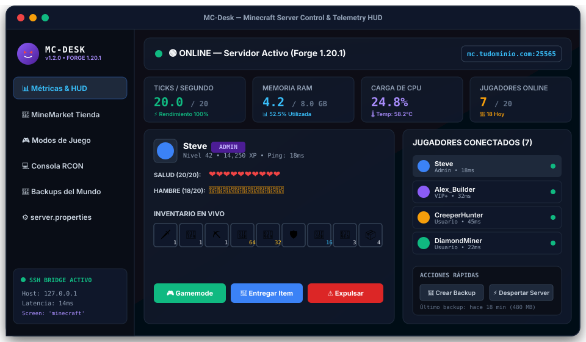
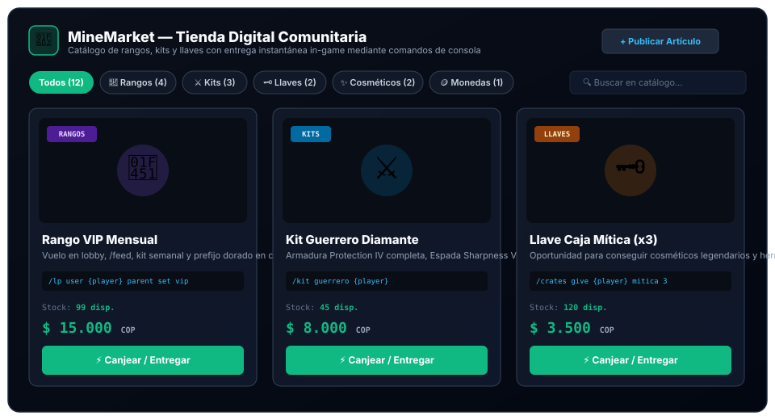
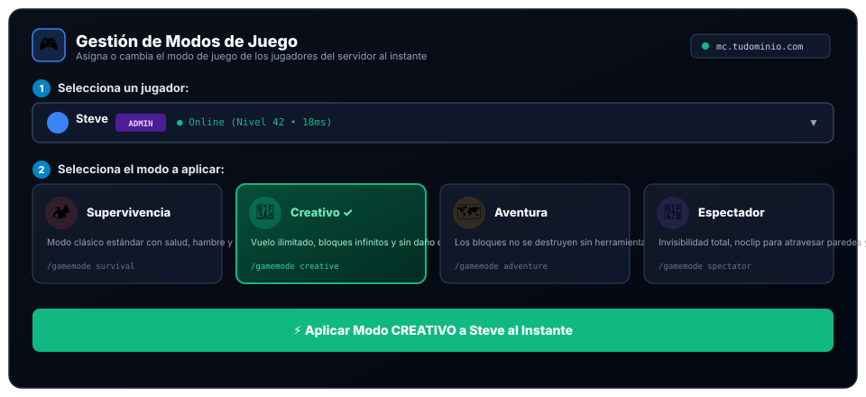
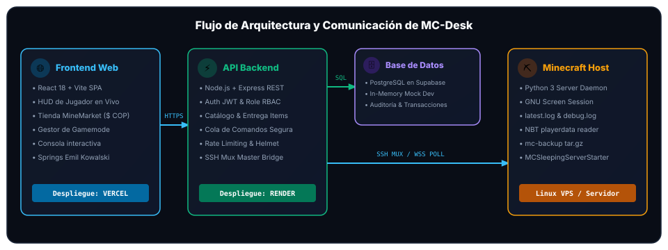

<div align="center">

  

  # ⚡ MC-DESK 👾
  ### *Panel Integral de Control, Telemetría HUD en Tiempo Real y Tienda Digital para Servidores de Minecraft*

  [](LICENSE)
  [](https://www.minecraft.net/)
  [](https://nodejs.org/)
  [](https://react.dev/)
  [](https://vitejs.dev/)
  [](https://tailscale.com/)

  <p align="center">
    <strong>Un accesorio definitivo "llave en mano" pensado para comunidades, creadores de servidores y administradores que buscan una experiencia de gestión premium, rápida y visualmente inmersiva.</strong>
  </p>

</div>

---

## 📑 Tabla de Contenidos

- [🎯 1. ¿Qué es MC-Desk y cuál es su Objetivo?](#-1-qué-es-mc-desk-y-cuál-es-su-objetivo)
- [🖼️ 2. Galería Visual del Aplicativo](#️-2-galería-visual-del-aplicativo)
  - [Dashboard General y Telemetría HUD](#dashboard-general-y-telemetría-hud)
  - [MineMarket: Tienda Comunitaria Integrada](#minemarket-tienda-comunitaria-integrada)
  - [Gestión Limpia de Modos de Juego (Gamemode)](#gestión-limpia-de-modos-de-juego-gamemode)
- [🏛️ 3. Arquitectura del Sistema y Flujo de Datos](#️-3-arquitectura-del-sistema-y-flujo-de-datos)
- [🌳 4. Árbol Detallado del Proyecto](#-4-árbol-detallado-del-proyecto)
- [🚀 5. Instalación y Puesta en Marcha](#-5-instalación-y-puesta-en-marcha)
  - [Paso 1: Configurar Variables de Entorno (.env.clone)](#paso-1-configurar-variables-de-entorno-envclone)
  - [Paso 2: Iniciar el Backend API](#paso-2-iniciar-el-backend-api)
  - [Paso 3: Iniciar el Frontend React](#paso-3-iniciar-el-frontend-react)
  - [Paso 4: Despliegue del Agente Linux (Opcional)](#paso-4-despliegue-del-agente-linux-opcional)
- [🔌 6. Referencia de Endpoints API REST](#-6-referencia-de-endpoints-api-rest)
- [🔒 7. Seguridad y Buenas Prácticas](#-7-seguridad-y-buenas-prácticas)
- [🌐 8. Despliegue en Producción (Vercel + Render + Supabase)](#-8-despliegue-en-producción-vercel--render--supabase)
- [📄 9. Licencia](#-9-licencia)

---

## 🎯 1. ¿Qué es MC-Desk y cuál es su Objetivo?

Los servidores de Minecraft comunitarios tradicionalmente dependen de paneles genéricos pesados (como Pterodactyl o Multicraft) que consumen recursos excesivos, son difíciles de montar, requieren apertura insegura de puertos o demandan plataformas externas costosas (Tebex, CraftingStore) con altas comisiones para vender rangos o kits.

**MC-Desk** fue diseñado desde cero para solucionar esto: es un **accesorio autónomo, liviano y listo para usar** que transforma cualquier servidor de Minecraft (Forge, Fabric, Paper, Spigot o Purpur) en un ecosistema profesional con:

1. **Monitoreo HUD en Tiempo Real:** Inspecciona vida en corazones de Minecraft, barra de hambre, armadura e inventario casilla por casilla de cada jugador conectado leyendo directamente archivos NBT y sockets sin lag.
2. **MineMarket Integrado:** Tienda digital nativa para la comunidad con precios en moneda local (**$ COP**), control de stock automático y entrega instantánea in-game mediante ejecución de comandos (`/lp user {player} parent set ...`, `/give {player} ...`).
3. **Gestor de Gamemode Dinámico:** Interfaz fluida y limpia para cambiar el modo de juego (`Supervivencia`, `Creativo`, `Aventura`, `Espectador`) de cualquier jugador con un solo clic.
4. **Cero Puertos Expuestos:** Conexión ultra segura a través de un daemon liviano en Python (`< 15 MB RAM`) con comunicación saliente o puente SSH multiplexado.
5. **Estética Minecraft & Microinteracciones:** Diseñado con pixel-art fiel a Minecraft, la mascota oficial **Gengar** y física de resortes táctiles inspirada en las reglas de *Design Engineering* de **Emil Kowalski**.

---

## 🖼️ 2. Galería Visual del Aplicativo

### Dashboard General y Telemetría HUD
Monitoreo de TPS (20.0), uso de memoria RAM, carga de CPU, jugadores activos, consola interactiva y tarjeta de inspección de inventario del jugador.

<div align="center">
  
</div>

---

### MineMarket: Tienda Comunitaria Integrada
Catálogo digital categorizado (Rangos, Kits, Llaves, Cosméticos, Monedas) con precios en `$ COP`, stock en tiempo real y modal transaccional de entrega instantánea de comandos al jugador seleccionado.

<div align="center">
  
</div>

---

### Gestión Limpia de Modos de Juego (Gamemode)
Selector rápido con retroalimentación táctil `:active { transform: scale(0.97); }` para alternar modos de juego al instante sin interferir con la experiencia del jugador.

<div align="center">
  
</div>

---

## 🏛️ 3. Arquitectura del Sistema y Flujo de Datos

```text
 ┌────────────────────────────────────────────────────────────────────────┐
 │                           CLIENTE / NAVEGADOR                          │
 │      Frontend Web (React 18 + Vite + TailwindCSS + Springs CSS)        │
 │            Métricas HUD • MineMarket • Gamemode • Consola             │
 └───────────────────────────────────┬────────────────────────────────────┘
                                     │ HTTPS / JWT
                                     ▼
 ┌────────────────────────────────────────────────────────────────────────┐
 │                           API BACKEND (Node.js)                        │
 │     Express REST • Auth RBAC • Queue de Comandos • SSH Master Mux      │
 └─────────────┬───────────────────────────────────────────┬──────────────┘
               │                                           │
       SQL Pool│                                  SSH Mux /│ Agent Polling
               ▼                                           ▼
 ┌───────────────────────────┐               ┌────────────────────────────┐
 │     BASE DE DATOS         │               │     SERVIDOR LINUX VPS     │
 │  PostgreSQL en Supabase   │               │   MC-Desk Python Daemon    │
 │  (o In-Memory Mock Dev)   │               │  GNU Screen Session 'mc'   │
 └───────────────────────────┘               └─────────────┬──────────────┘
                                                           │ Screen Stuff / NBT
                                                           ▼
                                             ┌────────────────────────────┐
                                             │      MINECRAFT SERVER      │
                                             │ Forge / Fabric / Paper     │
                                             │ latest.log • playerdata    │
                                             └────────────────────────────┘
```

<div align="center">
  
</div>

---

## 🌳 4. Árbol Detallado del Proyecto

A continuación se detalla la estructura completa de carpetas y componentes:

```text
MC-Desk/
├── .env.clone                  # Plantilla maestra de variables de entorno para todo el repo
├── .gitignore                  # Protección estricta: bloquea .env reales, node_modules y logs
├── README.md                   # Documentación principal del proyecto
├── render.yaml                 # Blueprint declarativo para despliegue automatizado en Render
├── mc.sh                       # CLI rápido para control remoto de servidor (status, start, stop)
├── mc-api.sh                   # CLI de administración del servicio del backend local o remoto
├── mc-red.py                   # Herramienta de diagnóstico de red, IP pública y túnel Tailscale
├── mc-status.py                # Script independiente de inspección de estado de Minecraft
│
├── docs/                       # Recursos visuales y documentación técnica
│   ├── database_schema_3nf.md  # 📘 Arquitectura de Base de Datos en 3NF y Manual de Seguridad
│   └── assets/
│       ├── gengar.jpg          # Mascota oficial del proyecto
│       ├── island.jpg          # Banner artístico de Minecraft
│       ├── creeper.jpg         # Arte de soporte
│       ├── dashboard_mockup.svg# Mockup vectorial del Dashboard
│       ├── minemarket_mockup.svg# Mockup vectorial de la Tienda MineMarket
│       ├── gamemode_mockup.svg # Mockup vectorial del Gestor de Gamemode
│       └── architecture_diagram.svg # Diagrama de arquitectura del sistema
│
├── backend/                    # Capa de Servicio API REST (Node.js + Express)
│   ├── .env.clone              # Plantilla de variables de entorno para backend
│   ├── .env.example            # Espejo compatible con despliegues de hosting
│   ├── package.json            # Dependencias del backend (express, cors, helmet, jsonwebtoken)
│   ├── data/
│   │   └── store.json          # Datos de prueba para In-Memory Mock en desarrollo
│   └── src/
│       ├── index.js            # Punto de entrada de la aplicación Express
│       ├── config/
│       │   └── index.js        # Carga centralizada y segura de variables con dotenv
│       ├── db/
│       │   ├── index.js        # Pool de conexión PostgreSQL con fallback a memoria
│       │   └── schema.sql      # Esquema DDL en 3NF (13 tablas, vistas, catálogos e índices)
│       ├── middleware/
│       │   ├── auth.js         # Verificación de tokens JWT con fijación de algoritmos y roles
│       │   ├── security.js     # Validador de complejidad, anti-timing attack y sanitizador
│       │   ├── agentAuth.js    # Autenticación segura de daemons de Minecraft
│       │   └── rateLimiter.js  # Limitador de peticiones contra ataques de fuerza bruta
│       ├── routes/
│       │   ├── auth.js         # Registro, Login y sesión (/api/auth)
│       │   ├── servers.js      # CRUD y reclamo de servidores (/api/servers)
│       │   ├── players.js      # Lista e inspección de jugadores (/api/players)
│       │   ├── items.js        # Catálogo MineMarket y entrega de items (/api/items)
│       │   ├── admin.js        # Comandos de consola y gamemode (/api/servers/:id/admin)
│       │   └── agent.js        # Handshake y sincronización con el daemon Linux
│       └── services/
│           ├── auditService.js # Registro cronológico de auditoría
│           ├── commandQueue.js # Cola asíncrona de comandos de servidor
│           ├── minecraftBridge.js # Puente SSH multiplexado de ultra baja latencia
│           ├── spawn_ssh_master.py # Inicializador pty para multiplexación SSH
│           └── mc_desk_collector.py # Recolector de métricas NBT y estado en el host
│
├── frontend/                   # Capa de Interfaz Web (React 18 + Vite)
│   ├── .env.clone              # Plantilla de variables para frontend (VITE_API_URL)
│   ├── .env.example
│   ├── index.html              # HTML con fuentes pixel y metadatos
│   ├── vite.config.js          # Configuración del bundler Vite
│   ├── package.json            # Dependencias React y utilidades
│   ├── public/                 # Sprites originales y texturas de Minecraft
│   │   └── assets/
│   │       ├── gengar.jpg
│   │       ├── island.jpg
│   │       ├── player.jpg
│   │       └── minecraft/textures/ # Texturas de bloques, items y HUD
│   └── src/
│       ├── main.jsx            # Entrada ReactDOM
│       ├── App.jsx             # Enrutador principal y layout
│       ├── api/
│       │   └── client.js       # Cliente HTTP centralizado con token Bearer
│       ├── context/
│       │   ├── AuthContext.jsx # Estado global de autenticación de usuario
│       │   └── ServerContext.jsx # Estado global del servidor seleccionado y polling
│       ├── styles/
│       │   ├── index.css       # Resets básicos
│       │   └── minecraft.css   # Estilos Pixel-Art, HUD, y física de resortes Emil Kowalski
│       ├── pages/
│       │   ├── Login.jsx       # Pantalla de acceso con modo Demo integrado
│       │   └── Dashboard.jsx   # Tablero central con selector de vistas
│       └── components/
│           ├── layout/
│           │   ├── Header.jsx  # Barra superior con estado del servidor e IP
│           │   └── Sidebar.jsx # Menú lateral con accesos directos
│           ├── ui/
│           │   ├── GengarLogo.jsx # Mascota animada en SVG
│           │   ├── HeartsBar.jsx  # Barra de corazones de vida (Pixel Art)
│           │   ├── FoodBar.jsx    # Barra de comida/hambre (Pixel Art)
│           │   ├── SignalBars.jsx # Indicador de latencia/ping
│           │   └── MinecraftSprites.jsx # Renderizador de iconos de items de Minecraft
│           └── dashboard/
│               ├── ServerStatusCard.jsx    # Tarjeta de estado (ONLINE / SLEEPING)
│               ├── QuickStatsCard.jsx      # Métricas rápidas (TPS, RAM, CPU)
│               ├── ConnectedPlayersList.jsx# Lista interactiva de jugadores
│               ├── PlayerProfileCard.jsx   # HUD con salud, comida, armadura e inventario
│               ├── InventoryCard.jsx       # Cuadrícula de inventario interactiva
│               ├── MineMarketView.jsx      # Tienda comunitaria y entrega de artículos
│               ├── GhostPanelCard.jsx      # Panel limpio de asignación de Gamemode
│               ├── ConsoleModal.jsx        # Terminal de comandos RCON interactiva
│               ├── BackupsModal.jsx        # Gestor y creador de copias de seguridad
│               ├── ServerPropertiesModal.jsx # Editor visual de server.properties
│               └── ClaimServerModal.jsx    # Modal de vinculación de nuevos servidores
│
└── server-agent/               # Daemon Opcional para Linux (Systemd)
    ├── agent.py                # Servicio en Python 3 que reporta métricas al backend
    ├── config.json.example     # Plantilla de configuración del agente
    ├── install.sh              # Script instalador automático de un solo paso
    └── README.md               # Manual de instalación del daemon
```

---

## 🚀 5. Instalación y Puesta en Marcha

### Prerrequisitos
* **Node.js 18+** y **npm** instalados.
* **Python 3.8+** (opcional, necesario si usas el puente SSH multiplexado o el daemon en Linux).

---

### Paso 1: Configurar Variables de Entorno (.env.clone)
Cada componente incluye su plantilla `.env.clone`. Copia las plantillas para crear tus archivos privados locales:

```bash
# 1. Copiar plantilla en el Backend
cd backend
cp .env.clone .env

# 2. Copiar plantilla en el Frontend
cd ../frontend
cp .env.clone .env
```

> [!TIP]
> Si estás probando en desarrollo local, **no necesitas instalar PostgreSQL**. Si dejas `DATABASE_URL` vacío en `backend/.env`, el backend automáticamente iniciará en modo **In-Memory Mock** con servidores, jugadores y tienda de prueba precargados.

---

### Paso 2: Iniciar el Backend API
En una terminal:
```bash
cd backend
npm install
npm run dev
```
El servidor responderá en `http://localhost:3000`.

---

### Paso 3: Iniciar el Frontend React
En otra terminal:
```bash
cd frontend
npm install
npm run dev
```
La aplicación web abrirá en `http://localhost:5173`. Puedes iniciar sesión con las credenciales por defecto o presionar **"Explorar en Modo Demo"** para ingresar inmediatamente.

---

### Paso 4: Despliegue del Agente Linux (Opcional)
Si deseas conectar un servidor real de Minecraft que corre en un VPS o máquina Linux:
1. Copia la carpeta `server-agent/` a tu servidor.
2. Copia `config.json.example` a `config.json` con la URL de tu API y el código generado en la interfaz web:
   ```json
   {
     "backend_url": "https://tu-api.onrender.com",
     "claim_code": "MC-DESK-8F42-X92K",
     "screen_session": "minecraft",
     "poll_interval_seconds": 5
   }
   ```
3. Instala como servicio Systemd:
   ```bash
   sudo ./install.sh
   ```

---

## 🔌 6. Referencia de Endpoints API REST

| Método | Endpoint | Descripción | Autenticación |
| :--- | :--- | :--- | :--- |
| `POST` | `/api/auth/register` | Registrar nuevo usuario administrador | Pública |
| `POST` | `/api/auth/login` | Iniciar sesión y obtener token JWT | Pública |
| `GET` | `/api/auth/me` | Obtener datos del perfil actual | Bearer JWT |
| `GET` | `/api/servers` | Listar servidores registrados con métricas en vivo | Bearer JWT |
| `POST` | `/api/servers` | Registrar nuevo servidor y generar código de reclamo | Bearer JWT |
| `GET` | `/api/players` | Obtener jugadores conectados y telemetría NBT | Bearer JWT |
| `GET` | `/api/items` | Obtener catálogo de artículos de la tienda MineMarket | Pública |
| `POST` | `/api/items` | Crear nuevo artículo en la tienda (Admin) | Bearer JWT |
| `POST` | `/api/items/:id/deliver` | Entregar item in-game ejecutando plantilla de comando | Bearer JWT |
| `POST` | `/api/servers/:id/admin/stealth-gamemode` | Cambiar modo de juego de un jugador al instante | Bearer JWT |
| `POST` | `/api/servers/:id/admin/command` | Enviar comando a la consola de Minecraft | Bearer JWT |
| `GET` | `/api/servers/:id/admin/backups` | Listar copias de seguridad `.tar.gz` | Bearer JWT |
| `POST` | `/api/servers/:id/admin/backups` | Disparar generación de nueva copia de seguridad | Bearer JWT |
| `GET` | `/api/servers/:id/admin/properties` | Obtener pares clave-valor de `server.properties` | Bearer JWT |
| `PUT` | `/api/servers/:id/admin/properties` | Actualizar configuración de `server.properties` | Bearer JWT |

---

## 🔒 7. Seguridad y Buenas Prácticas

1. **Variables de Entorno Estrictas:** Ninguna IP, contraseña de host o clave criptográfica se guarda en el repositorio. Solo se rastrean los archivos `.env.clone` y `.env.example`.
2. **Contraseñas Hasheadas:** Las contraseñas se almacenan cifradas con `bcryptjs` con 10 rondas de salt.
3. **Control de Acceso por Roles (RBAC):** Funciones de consola, backups y asignación de modos de juego restringidas a roles `ADMIN` y `OWNER`.
4. **Protección de Cabeceras y Limitador:** Seguridad HTTP implementada mediante `helmet` y limitador de velocidad `express-rate-limit`.
5. **Auditoría Transaccional:** Cada comando enviado a la consola o compra en MineMarket queda auditado con marca de tiempo e identidad del emisor.

---

## 🌐 8. Despliegue en Producción (Vercel + Render + Supabase)

### Despliegue del Frontend en Vercel
1. Conecta tu repositorio de GitHub en [Vercel](https://vercel.com).
2. Configura el **Root Directory** en `frontend`.
3. Establece la variable de entorno:
   * `VITE_API_URL`: `https://tu-backend-mc-desk.onrender.com`
   * `VITE_MC_DEFAULT_HOST`: `mc.tudominio.com`
4. Presiona **Deploy**.

### Despliegue del Backend en Render
1. Conecta tu repositorio en [Render](https://render.com).
2. Crea un **Web Service** seleccionando el **Root Directory** `backend` (o usa el blueprint automático `render.yaml`).
3. Agrega las variables de entorno privadas en el dashboard de Render:
   * `NODE_ENV`: `production`
   * `PORT`: `10000`
   * `DATABASE_URL`: Tu URI de conexión a PostgreSQL de Supabase.
   * `JWT_SECRET`: Una clave aleatoria de 64 caracteres.
   * `FRONTEND_ORIGIN`: La URL de tu frontend en Vercel (`https://mc-desk.vercel.app`).

---

## 📄 9. Licencia

Distribuido bajo la Licencia **MIT**. Consulta el archivo `LICENSE` para más información.

<div align="center">
  <sub>Desarrollado con ❤️ y píxeles para la comunidad global de Minecraft.</sub>
</div>
