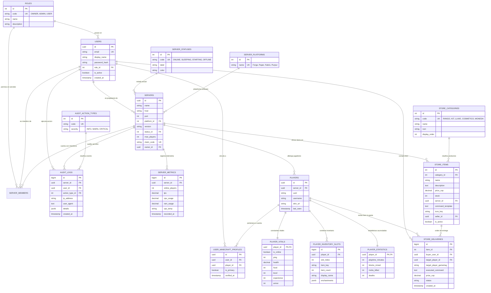

# MC-Desk: Arquitectura de Base de Datos en Tercera Forma Normal (3NF) y Manual de Seguridad Integral

> **Versión:** 2.0.0  
> **Motor de Persistencia Principal:** PostgreSQL 15+ / Supabase  
> **Capa de Abstracción en Desarrollo:** Dynamic In-Memory + JSON Store (`backend/data/store.json`)  
> **Fecha de Publicación:** Noviembre 2026  

---

## 1. Resumen Ejecutivo y Objetivos del Sistema

**MC-Desk** es una plataforma moderna para la administración, monitoreo telemétrico en tiempo real y comercialización digital (*MineMarket*) para servidores de Minecraft (Forge, Paper, Fabric, Purpur, Spigot).

### Objetivos de la Normalización a 3NF
1. **Erradicación de Anomalías de Datos:**
   - **Anomalías de Inserción:** Imposibilidad de registrar nuevas entidades (ej. categorías de tienda o roles) sin tener que inventar tuplas ficticias de usuarios o servidores.
   - **Anomalías de Modificación:** Inconsistencia de datos cuando un atributo repetido (como el nombre o color de un estado de servidor) se actualiza en unas filas pero en otras no.
   - **Anomalías de Eliminación:** Pérdida accidental de datos descriptivos al borrar una tupla principal (ej. si se borraba el único ítem de un tipo, se perdía la categoría en el sistema).
2. **Atomicidad e Indexación Relacional:** Reemplazar estructuras complejas no relacionales (como arrays o JSONs gigantes embebidos de inventario) por tuplas atómicas indexables que permitan consultas relacionales optimizadas, agregaciones SQL y bloqueos granulares por fila (`ROW LEVEL LOCKS`).
3. **Desacoplamiento Estricto de Identidades:** Separación formal entre el **Usuario Web de la plataforma** y el **Jugador in-game de Minecraft**, manteniendo la regla de negocio que vincula a cada jugador regular con su personaje dentro del servidor mientras los administradores conservan permisos globales de operador.

---

## 2. Demostración y Justificación Matemática de las Formas Normales

Sea un esquema de base de datos relacional $R = (U, F)$, donde $U$ es el conjunto universal de atributos y $F$ es el conjunto de dependencias funcionales de la forma $X \to Y$.

### 2.1 Primera Forma Normal (1NF): Atomicidad e Identificadores Únicos

#### Definición Formal
> Una relación $R$ está en **1NF** si y solo si todos los atributos de su esquema tienen dominios con **valores atómicos** (indivisibles) y no existen grupos repetitivos, tuplas duplicadas ni atributos multivaluados embebidos.

$$\forall A \in \text{attrs}(R), \quad \forall t \in R, \quad t[A] \in \text{dom}(A) \quad (\text{donde } \text{dom}(A) \text{ es atómico})$$

#### Estado Previo (No 1NF)
En las versiones iniciales, la entidad de jugadores contenía una columna `inventory JSONB`:
```json
{
  "inventory": [
    { "slot": 0, "item": "diamond_sword", "count": 1, "enchantments": [...] },
    { "slot": 1, "item": "golden_apple", "count": 64 }
  ]
}
```
Esto violaba la 1NF al almacenar colecciones multivaluadas repetitivas en una sola celda, impidiendo la indexación nativa por ítem y búsquedas eficientes mediante cláusulas `WHERE`.

#### Transformación a 1NF
Se creó la tabla normalizada `player_inventory_slots`:
- **Atributos:** `(id, player_id, slot_index, item_key, item_count, display_name, enchantments, updated_at)`
- **Clave Primaria:** `id` (`BIGSERIAL PRIMARY KEY`)
- **Restricción de Atomicidad y Unicidad:** `CONSTRAINT unique_player_inventory_slot UNIQUE (player_id, slot_index)`
- **Restricción de Dominio:** `CHECK (slot_index >= 0 AND slot_index <= 45)` y `CHECK (item_count > 0 AND item_count <= 64)`

---

### 2.2 Segunda Forma Normal (2NF): Dependencia Funcional Completa

#### Definición Formal
> Una relación $R$ está en **2NF** si y solo si está en **1NF** y ningún atributo no-primo $A$ (atributo que no pertenece a ninguna clave candidata) depende funcionalmente de un subconjunto propio de cualquier clave candidata $K$ de $R$.

$$\forall K \text{ (clave candidata)}, \quad \forall X \subset K, \quad \neg(X \to A) \quad \text{para todo atributo no-primo } A$$

#### Eliminación de Dependencias Parciales
Para todas las tablas compuestas (como miembros de servidor o vinculaciones entre cuentas web y perfiles de Minecraft):
- En lugar de permitir que atributos descriptivos dependan parcialmente de una clave primaria compuesta, se implementaron **claves subrogadas** (`UUID` o `BIGSERIAL`) como clave primaria física, y se aplicaron restricciones de unicidad compuestas (`UNIQUE`) sobre las claves naturales:
  - `server_members`: Clave primaria `id UUID`, con restricción `UNIQUE (server_id, user_id)`.
  - `players`: Clave primaria `id UUID`, con restricción `UNIQUE (server_id, uuid)`.
  - `user_minecraft_profiles`: Clave primaria `id UUID`, con restricción `UNIQUE (user_id, player_id)`.
- Todos los atributos no-clave dependen **funcionalmente de la clave completa** ($K \to A$).

---

### 2.3 Tercera Forma Normal (3NF): Eliminación de Dependencias Transitivas

#### Definición Formal
> Una relación $R$ está en **3NF** si y solo si está en **2NF** y para toda dependencia funcional no trivial $X \to Y \in F^+$, se cumple al menos una de las siguientes condiciones:
> 1. $X$ es una superclave de $R$.
> 2. $Y$ es un atributo primo (pertenece a alguna clave candidata de $R$).

En términos directos, **ningún atributo no-clave puede depender de otro atributo no-clave** ($X \to Y \land Y \to Z$ donde $Z$ es un atributo no-primo).

#### Descomposiciones Aplicadas a 3NF

| Entidad Original | Dependencia Transitiva Detectada | Descomposición en 3NF | Tablas Resultantes |
|---|---|---|---|
| **Usuarios** | `user_id -> role_id -> {role_code, role_name}` | Se extrae la entidad de roles a un catálogo normalizado. | `roles`, `users` |
| **Servidores** | `server_id -> status_id -> {status_code, color, label}` | Se extrae el estado del servidor a un catálogo normalizado. | `server_statuses`, `servers` |
| **Plataformas** | `server_id -> platform_id -> {platform_name}` | Se desacopla el software (Forge, Paper, Fabric). | `server_platforms`, `servers` |
| **Telemetría** | `server_id -> {online_players, tps, cpu_usage, ram_usage}` | Se separa la serie temporal volátil de la configuración estática. | `servers`, `server_metrics` |
| **Catálogo Tienda**| `item_id -> category_id -> {category_name, icon, order}` | Se extrae la categoría del producto a catálogo. | `store_categories`, `store_items` |
| **Auditoría** | `audit_id -> user_id -> {user_email}` | Se eliminó la redundancia de `user_email` guardando únicamente `user_id`. | `audit_logs`, `audit_action_types` |
| **Perfil Jugador**| `user_id -> player_id -> {uuid, username, vitals}` | Se desacopló la cuenta web de la identidad de juego en el servidor. | `users`, `players`, `user_minecraft_profiles` |

---

## 3. Diagrama Entidad-Relación (ERD Mermaid)



---

## 4. Diccionario de Datos Completo (Data Dictionary)

### 4.1 Tablas de Seguridad y Control de Acceso (RBAC)

#### `roles`
Catálogo de roles universales del sistema.
| Columna | Tipo de Dato | Modificadores | Descripción |
|---|---|---|---|
| `id` | `SERIAL` | `PRIMARY KEY` | Identificador autoincremental del rol |
| `code` | `VARCHAR(20)` | `UNIQUE NOT NULL` | Código de control: `'OWNER'`, `'ADMIN'`, `'USER'` |
| `name` | `VARCHAR(50)` | `NOT NULL` | Nombre descriptivo del rol |
| `description` | `TEXT` | `NULL` | Alcance y permisos detallados |
| `created_at` | `TIMESTAMPTZ` | `NOT NULL DEFAULT NOW()` | Fecha de registro |

#### `users`
Cuentas de acceso web al panel MC-Desk.
| Columna | Tipo de Dato | Modificadores | Descripción |
|---|---|---|---|
| `id` | `UUID` | `PRIMARY KEY DEFAULT gen_random_uuid()` | Clave primaria criptográficamente segura |
| `email` | `VARCHAR(255)` | `UNIQUE NOT NULL` | Correo electrónico normalizado en minúsculas |
| `display_name` | `VARCHAR(100)` | `NOT NULL` | Nombre público en la interfaz web |
| `password_hash` | `VARCHAR(255)` | `NOT NULL` | Hash bcrypt (factor de trabajo: 10 rondas) |
| `role_id` | `INTEGER` | `NOT NULL REFERENCES roles(id)` | Rol asignado al usuario |
| `is_active` | `BOOLEAN` | `NOT NULL DEFAULT TRUE` | Bandera de habilitación de cuenta |
| `created_at` | `TIMESTAMPTZ` | `NOT NULL DEFAULT NOW()` | Fecha de creación de la cuenta |
| `updated_at` | `TIMESTAMPTZ` | `NOT NULL DEFAULT NOW()` | Fecha de última actualización |

---

### 4.2 Servidores, Infraestructura y Telemetría

#### `server_statuses`
Catálogo de estados de ciclo de vida del servidor.
| Columna | Tipo de Dato | Modificadores | Descripción |
|---|---|---|---|
| `id` | `SERIAL` | `PRIMARY KEY` | Identificador del estado |
| `code` | `VARCHAR(20)` | `UNIQUE NOT NULL` | `'ONLINE'`, `'SLEEPING'`, `'STARTING'`, `'OFFLINE'` |
| `label` | `VARCHAR(50)` | `NOT NULL` | Etiqueta con emoticono representativo |
| `color` | `VARCHAR(20)` | `NOT NULL DEFAULT '#10b981'` | Código hexadecimal para UI |

#### `server_platforms`
Catálogo de motores de ejecución de Minecraft.
| Columna | Tipo de Dato | Modificadores | Descripción |
|---|---|---|---|
| `id` | `SERIAL` | `PRIMARY KEY` | Identificador de plataforma |
| `name` | `VARCHAR(50)` | `UNIQUE NOT NULL` | `'Forge'`, `'Paper'`, `'Fabric'`, `'Purpur'`, `'Spigot'` |

#### `servers`
Instancias de servidores de Minecraft gestionadas por la plataforma.
| Columna | Tipo de Dato | Modificadores | Descripción |
|---|---|---|---|
| `id` | `UUID` | `PRIMARY KEY DEFAULT gen_random_uuid()` | Identificador único del servidor |
| `name` | `VARCHAR(100)` | `NOT NULL` | Nombre descriptivo del servidor |
| `host` | `VARCHAR(255)` | `NOT NULL` | IP o dominio público/privado de conexión |
| `port` | `INTEGER` | `NOT NULL DEFAULT 25565` | Puerto TCP de Minecraft |
| `platform_id` | `INTEGER` | `REFERENCES server_platforms(id)` | Motor de Minecraft |
| `version` | `VARCHAR(30)` | `NOT NULL DEFAULT '1.20.1'` | Versión de Minecraft |
| `status_id` | `INTEGER` | `NOT NULL REFERENCES server_statuses(id)` | Estado actual de ejecución |
| `max_players` | `INTEGER` | `NOT NULL DEFAULT 20` | Capacidad máxima de jugadores |
| `claim_code` | `VARCHAR(50)` | `UNIQUE NULL` | Código de emparejamiento con el Agent local |
| `claim_code_expires` | `TIMESTAMPTZ` | `NULL` | Expiración del código de reclamo |
| `agent_token` | `VARCHAR(255)` | `UNIQUE NULL` | Token criptográfico HMAC para el daemon Python |
| `is_verified` | `BOOLEAN` | `NOT NULL DEFAULT FALSE` | Si el agente ha completado el handshake |
| `owner_id` | `UUID` | `NOT NULL REFERENCES users(id) ON DELETE CASCADE` | Propietario del servidor |
| `last_ping_at` | `TIMESTAMPTZ` | `NULL` | Último pulso de latido (heartbeat) recibido |
| `created_at` | `TIMESTAMPTZ` | `NOT NULL DEFAULT NOW()` | Fecha de alta |

#### `server_metrics`
Telemetría histórica y métricas de rendimiento en tiempo real.
| Columna | Tipo de Dato | Modificadores | Descripción |
|---|---|---|---|
| `id` | `BIGSERIAL` | `PRIMARY KEY` | Identificador de medición telemétrica |
| `server_id` | `UUID` | `NOT NULL REFERENCES servers(id) ON DELETE CASCADE` | Servidor medido |
| `online_players` | `INTEGER` | `NOT NULL DEFAULT 0` | Cantidad de jugadores concurrentes |
| `tps` | `NUMERIC(4, 2)` | `NOT NULL DEFAULT 20.00` | Ticks por segundo (ideal: 20.00) |
| `cpu_usage` | `NUMERIC(5, 2)` | `NOT NULL DEFAULT 0.0` | Porcentaje de uso de procesador |
| `ram_usage` | `NUMERIC(5, 2)` | `NOT NULL DEFAULT 0.0` | Memoria RAM utilizada (MB o %) |
| `cpu_temp` | `VARCHAR(20)` | `DEFAULT 'N/D'` | Temperatura de CPU reportada por el agente |
| `recorded_at` | `TIMESTAMPTZ` | `NOT NULL DEFAULT NOW()` | Marca temporal de la muestra |

---

### 4.3 Jugadores, Inventarios y Constantes Vitales

#### `players`
Identidad persistente de un jugador en un servidor específico.
| Columna | Tipo de Dato | Modificadores | Descripción |
|---|---|---|---|
| `id` | `UUID` | `PRIMARY KEY DEFAULT gen_random_uuid()` | Identificador relacional |
| `server_id` | `UUID` | `NOT NULL REFERENCES servers(id) ON DELETE CASCADE` | Servidor al que pertenece |
| `uuid` | `VARCHAR(64)` | `NOT NULL` | UUID oficial o offline del jugador de Minecraft |
| `username` | `VARCHAR(64)` | `NOT NULL` | Gamertag / Nombre de usuario in-game |
| `skin_url` | `TEXT` | `NULL` | Enlace CDN al avatar/skin (`mc-heads.net`) |
| `last_seen` | `TIMESTAMPTZ` | `DEFAULT NOW()` | Última conexión registrada |

#### `user_minecraft_profiles`
Tabla relacional para el desacoplamiento de Usuarios Web y Personajes in-game.
| Columna | Tipo de Dato | Modificadores | Descripción |
|---|---|---|---|
| `id` | `UUID` | `PRIMARY KEY DEFAULT gen_random_uuid()` | Clave subrogada |
| `user_id` | `UUID` | `NOT NULL REFERENCES users(id) ON DELETE CASCADE` | Cuenta web |
| `player_id` | `UUID` | `NOT NULL REFERENCES players(id) ON DELETE CASCADE` | Personaje in-game |
| `is_primary` | `BOOLEAN` | `NOT NULL DEFAULT TRUE` | Si es el perfil activo por defecto |
| `verified_at` | `TIMESTAMPTZ` | `DEFAULT NOW()` | Fecha de confirmación y vinculación |

#### `player_vitals`
Constantes vitales del HUD del jugador en tiempo real.
| Columna | Tipo de Dato | Modificadores | Descripción |
|---|---|---|---|
| `player_id` | `UUID` | `PRIMARY KEY REFERENCES players(id) ON DELETE CASCADE` | Relación 1:1 con `players` |
| `is_online` | `BOOLEAN` | `NOT NULL DEFAULT FALSE` | Estado de conexión en el servidor |
| `ping` | `INTEGER` | `DEFAULT 0` | Latencia de red en milisegundos |
| `health` | `NUMERIC(4, 1)` | `NOT NULL DEFAULT 20.0` | Puntos de vida (0.0 a 20.0) |
| `food` | `INTEGER` | `NOT NULL DEFAULT 20` | Puntos de comida/hambre (0 a 20) |
| `level` | `INTEGER` | `NOT NULL DEFAULT 0` | Nivel de experiencia acumulado |
| `experience`| `INTEGER` | `NOT NULL DEFAULT 0` | Puntos de XP de la barra actual |
| `armor` | `INTEGER` | `NOT NULL DEFAULT 0` | Puntos de armadura física |

#### `player_inventory_slots`
Inventario desagregado atómicamente hasta la 1NF.
| Columna | Tipo de Dato | Modificadores | Descripción |
|---|---|---|---|
| `id` | `BIGSERIAL` | `PRIMARY KEY` | Identificador de ranura |
| `player_id` | `UUID` | `NOT NULL REFERENCES players(id) ON DELETE CASCADE` | Propietario del inventario |
| `slot_index` | `INTEGER` | `NOT NULL CHECK (slot_index >= 0 AND slot_index <= 45)` | Ranura física (0 a 45) |
| `item_key` | `VARCHAR(80)` | `NOT NULL` | ID de Minecraft (ej. `'netherite_sword'`) |
| `item_count` | `INTEGER` | `NOT NULL CHECK (item_count > 0 AND item_count <= 64)` | Cantidad acumulada |
| `display_name` | `VARCHAR(120)` | `NULL` | Nombre personalizado o con lore |
| `enchantments` | `JSONB` | `NULL` | Metadatos de encantamientos |

---

### 4.4 Catálogo y Transacciones Digitales (MineMarket)

#### `store_categories`
Clasificación de productos en la tienda virtual.
| Columna | Tipo de Dato | Modificadores | Descripción |
|---|---|---|---|
| `id` | `SERIAL` | `PRIMARY KEY` | Identificador de categoría |
| `code` | `VARCHAR(30)` | `UNIQUE NOT NULL` | `'RANGO'`, `'KIT'`, `'LLAVE'`, `'COSMETICO'`, `'MONEDA'` |
| `name` | `VARCHAR(50)` | `NOT NULL` | Nombre visible en UI |
| `icon` | `VARCHAR(50)` | `NOT NULL DEFAULT 'diamond'` | Identificador del icono temático |
| `display_order` | `INTEGER` | `NOT NULL DEFAULT 0` | Orden de visualización |

#### `store_items`
Catálogo de ítems digitales disponibles para adquisición.
| Columna | Tipo de Dato | Modificadores | Descripción |
|---|---|---|---|
| `id` | `SERIAL` | `PRIMARY KEY` | Identificador del ítem |
| `category_id` | `INTEGER` | `NOT NULL REFERENCES store_categories(id)` | Categoría del producto |
| `name` | `VARCHAR(120)` | `NOT NULL` | Título del producto |
| `description` | `TEXT` | `NOT NULL` | Beneficios y contenido del producto |
| `price_cop` | `NUMERIC(12, 2)`| `NOT NULL CHECK (price_cop >= 0)` | Precio en moneda colombiana (COP) |
| `stock` | `INTEGER` | `NOT NULL DEFAULT 100 CHECK (stock >= 0)` | Existencias disponibles |
| `server_id` | `UUID` | `REFERENCES servers(id) ON DELETE SET NULL` | Servidor donde se redime |
| `command_template` | `TEXT` | `NOT NULL` | Plantilla del comando (ej. `lp user {player} parent set vip`) |
| `icon_key` | `VARCHAR(80)` | `NOT NULL DEFAULT 'diamond'` | Icono visual representativo |
| `seller_id` | `UUID` | `REFERENCES users(id) ON DELETE SET NULL` | Vendedor/Administrador que creó el ítem |
| `is_active` | `BOOLEAN` | `NOT NULL DEFAULT TRUE` | Habilitado en la tienda |

#### `store_deliveries`
Auditoría y registro inmutable de transacciones y entregas digitales in-game.
| Columna | Tipo de Dato | Modificadores | Descripción |
|---|---|---|---|
| `id` | `BIGSERIAL` | `PRIMARY KEY` | Identificador de entrega |
| `item_id` | `INTEGER` | `NOT NULL REFERENCES store_items(id)` | Ítem comprado |
| `buyer_user_id`| `UUID` | `NOT NULL REFERENCES users(id) ON DELETE RESTRICT`| Usuario que realizó la compra |
| `target_player_id` | `UUID` | `REFERENCES players(id) ON DELETE SET NULL` | Jugador que recibe los beneficios |
| `target_player_gamertag` | `VARCHAR(64)` | `NOT NULL` | Gamertag validado en la entrega |
| `executed_command` | `TEXT` | `NOT NULL` | Comando exacto ejecutado en la consola |
| `price_cop` | `NUMERIC(12, 2)`| `NOT NULL` | Precio cobrado en el momento de la transacción |
| `status` | `VARCHAR(20)` | `CHECK (status IN ('PENDING', 'DELIVERED', 'FAILED'))` | Estado de entrega |
| `delivery_output` | `TEXT` | `NULL` | Respuesta devuelta por el servidor de Minecraft |
| `created_at` | `TIMESTAMPTZ` | `NOT NULL DEFAULT NOW()` | Marca de tiempo inmutable de la compra |

---

### 4.5 Trazabilidad y Auditoría de Seguridad

#### `audit_action_types`
Catálogo de eventos del sistema con clasificación de severidad.
| Columna | Tipo de Dato | Modificadores | Descripción |
|---|---|---|---|
| `id` | `SERIAL` | `PRIMARY KEY` | Identificador de tipo de acción |
| `code` | `VARCHAR(50)` | `UNIQUE NOT NULL` | `'USER_LOGIN'`, `'CONSOLE_COMMAND'`, etc. |
| `severity` | `VARCHAR(20)` | `CHECK (severity IN ('INFO', 'WARN', 'CRITICAL'))` | Nivel de criticidad |

#### `audit_logs`
Bitácora de seguridad con integridad referencial.
| Columna | Tipo de Dato | Modificadores | Descripción |
|---|---|---|---|
| `id` | `BIGSERIAL` | `PRIMARY KEY` | Identificador del log |
| `server_id` | `UUID` | `REFERENCES servers(id) ON DELETE SET NULL` | Servidor relacionado (si aplica) |
| `user_id` | `UUID` | `REFERENCES users(id) ON DELETE SET NULL` | Usuario responsable del evento |
| `action_type_id` | `INTEGER` | `NOT NULL REFERENCES audit_action_types(id)` | Tipo de acción clasificada |
| `ip_address` | `VARCHAR(45)` | `NULL` | Dirección IPv4 o IPv6 de origen |
| `user_agent` | `TEXT` | `NULL` | Navegador o cliente emisor |
| `details` | `JSONB` | `NULL` | Contexto extendido del evento |
| `created_at` | `TIMESTAMPTZ` | `NOT NULL DEFAULT NOW()` | Fecha y hora exacta del suceso |

---

## 5. Vistas SQL para Consultas de Alto Rendimiento

Para facilitar el desarrollo frontend sin incurrir en múltiples JOINs manuales en el backend, se incluyen dos vistas materializables:

### 5.1 Vista: `v_user_profiles`
Desnormaliza la relación de usuarios con su personaje de Minecraft vinculado y avatar de skin:
```sql
CREATE OR REPLACE VIEW v_user_profiles AS
SELECT 
    u.id,
    u.email,
    u.display_name,
    r.code AS role,
    p.username AS minecraft_username,
    p.uuid AS minecraft_uuid,
    COALESCE(p.skin_url, 'https://mc-heads.net/avatar/' || COALESCE(p.username, 'Steve')) AS avatar_url,
    u.is_active,
    u.created_at,
    u.updated_at
FROM users u
JOIN roles r ON u.role_id = r.id
LEFT JOIN user_minecraft_profiles ump ON u.id = ump.user_id AND ump.is_primary = TRUE
LEFT JOIN players p ON ump.player_id = p.id;
```

### 5.2 Vista: `v_players_with_vitals`
Agrega la información estática del jugador junto con sus constantes de salud, comida y estadísticas de juego:
```sql
CREATE OR REPLACE VIEW v_players_with_vitals AS
SELECT 
    p.id,
    p.server_id,
    p.uuid,
    p.username,
    COALESCE(p.skin_url, 'https://mc-heads.net/avatar/' || p.username) AS skin_url,
    v.is_online,
    v.ping,
    v.health,
    v.food,
    v.level,
    v.experience,
    v.armor,
    s.playtime_minutes,
    s.blocks_mined,
    s.mobs_killed,
    s.deaths,
    p.last_seen
FROM players p
LEFT JOIN player_vitals v ON p.id = v.player_id
LEFT JOIN player_statistics s ON p.id = s.player_id;
```

---

## 6. Prácticas y Medidas de Seguridad Implementadas

### 6.1 Seguridad en la Autenticación y Login

1. **Política Estricta de Complejidad de Contraseñas (`validatePasswordPolicy`):**
   - Longitud mínima de **8 caracteres** y máxima de 72 (límite nativo de bcrypt).
   - Verificación obligatoria de al menos una letra minúscula (`a-z`), una mayúscula (`A-Z`), un número (`0-9`) y un carácter especial (`!@#$%^&*()_+-=[]{};':"|,.<>/?~`\`).
   - Retorno de listas de errores explícitas ante contraseñas inseguras.

2. **Mitigación de Ataques de Temporización (*Timing Attacks* & Enumeración de Cuentas):**
   - En el endpoint `/api/auth/login`, si el correo ingresado no existe en la base de datos, el servidor calcula de todos modos un hash dummy con `bcrypt.compare` utilizando un factor de coste idéntico (10 rondas):
     ```javascript
     const hashToCompare = user ? user.password_hash : DUMMY_BCRYPT_HASH;
     const isMatch = await bcrypt.compare(password, hashToCompare).catch(() => false);
     ```
   - Esto garantiza que el tiempo de respuesta estadístico de la API sea indistinguible entre usuarios existentes y no existentes, neutralizando la enumeración de correos por discrepancia de milisegundos.
   - Mensaje de error genérico: `"Credenciales inválidas. Verifica tu correo o contraseña."`

3. **Protección Anti-Fuerza Bruta (*Rate Limiting* Dedicado):**
   - Limitador de tasa estricto en `/api/auth/*` configurado a un máximo de 20 intentos por IP en una ventana de 15 minutos mediante `express-rate-limit`.
   - Registro de auditoría `USER_LOGIN_FAILED` con dirección IP y User-Agent ante cualquier intento fallido.

4. **Blindaje de Tokens de Sesión (JWT Hardening):**
   - Algoritmo criptográfico explícito: `HS256`.
   - Fijación de metadatos de emisor (`issuer: 'mcdesk-api'`) y audiencia (`audience: 'mcdesk-web'`).
   - Algoritmo fijado en `jwt.verify({ algorithms: ['HS256'] })` para prevenir ataques de degradación a algoritmo `none`.
   - Tiempo de expiración estricto de 24 horas.

---

### 6.2 Seguridad en Todo el Aplicativo Web

1. **Prevención de Inyección de Comandos (*Command Injection* & *Shell Breakout*):**
   - El middleware `sanitizeConsoleCommand` intercepta todo comando emitido hacia la consola del servidor (RCON o terminal `screen` de Linux).
   - **Caracteres Prohibidos Bloqueados:** `;`, `&`, `|`, `` ` ``, `$`, `>`, `<`, `\`, saltos de línea (`\n`, `\r`) y bytes nulos (`\0`).
   - **Detección de Subshells:** Bloqueo de patrones como `$(...)`, `` `...` `` y `${...}`.
   - Longitud máxima controlada de 250 caracteres.
   - Eliminación de slashes iniciales redundantes (`/give` $\to$ `give`).
   - Sanitización rigurosa de Gamertags de entrega mediante lista blanca: `/^[a-zA-Z0-9_]{2,16}$/`.

2. **Cabeceras HTTP de Alta Seguridad mediante Helmet:**
   - **Content Security Policy (CSP):** Restricción de fuentes autorizadas para scripts, estilos (`Google Fonts`), avatares de Minecraft (`mc-heads.net`, `crafatar.com`) y conexiones WebSocket/HTTP locales y privadas.
   - **HSTS (HTTP Strict Transport Security):** Forzado de HTTPS por 1 año (`max-age=31536000`), con inclusión de subdominios y soporte de precarga (`preload`).
   - **X-Frame-Options:** `DENY` para protección completa contra *Clickjacking*.
   - **X-Content-Type-Options:** `nosniff` para evitar ataques de tipo MIME sniffing.
   - **Referrer-Policy:** `strict-origin-when-cross-origin`.

3. **Prevención de Inyección SQL (SQLi):**
   - Todas las consultas ejecutadas contra PostgreSQL (`pg` Pool) hacen uso exclusivo de **consultas parametrizadas** (`$1`, `$2`, `$3`), asegurando que ningún dato suministrado por el usuario sea concatenado en la instrucción SQL.

4. **Sanitización de Errores y Protección contra Fuga de Información:**
   - El manejador global de excepciones en `backend/src/index.js` detecta el entorno de ejecución (`NODE_ENV === 'production'`) y oculta los detalles de controladores de base de datos, rutas internas del disco y *stack traces*, retornando únicamente mensajes genéricos y seguros a los clientes web.

5. **Control de Acceso Basado en Roles (RBAC):**
   - Usuarios comunes (`USER`): Acceso limitado exclusivamente a la visualización de su servidor y su inventario, y compras en MineMarket dirigidas **únicamente a su propio Gamertag vinculado**.
   - Administradores (`ADMIN` / `OWNER`): Acceso a la consola remota, configuración de propiedades de servidor, administración de copias de seguridad y catálogo de la tienda.
